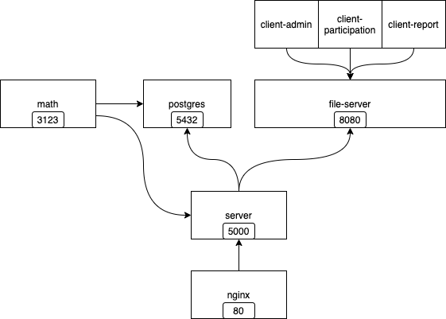

# 
This repo is maintained by the Copernicani association and is a research effort built on a fork of the Polis project developed by the Computational Democracy Project.

Please note that PolisOrbis now evolves as the **Voxit** project (https://www.voxit.org/). This repository is still maintained for legacy purposes.

To achieve the PolisOrbis objectives (https://doc.polisorbis.copernicani.it/overview/#why-polisorbis), we have rewritten a substantial portion of the code for three key components of Polis: 

- client-admin
- client-participation
- server

Besides PolisOrbis objectives, starting from v1.3.0 a new route was added to the server to automatically clean up all conversations older than two days by default. Starting from v 1.4.0 the purge script is scheduled as a cron job, by defaults it runs every day a 3 AM removing all conversations older than 48 hours and purging users without conversations. This behaviour is for the sandbox implementation. You can change it by defining two variables:
- PRUNE_SCHEDULE (defaults to 0 3 * * * according to cron syntax)
- PRUNE_OLDER_THAN (defaults to 172800, i.e. 48 hours in seconds)
Production configuratio may need a longer data retention.


Furthermore, minor adjustments have been made to other components throughout the Polis system.

PolisOrbis tries to remain as aligned as possible with the original Polis project methods, architecture and developments.


## 🎈 🪁 Start here! 🪁 🎈

If you're interested in using or contributing to PolisOrbis, please see the following:
- [**PolisOrbis documentation portal**](https://doc.polisorbis.copernicani.it/): here you find the service deployment manual and the technical documentation
- [**PolisOrbis Reference deployment**](): the reference deployment of the PolisOrbis service maintained by Copernicani
- [**PolisOrbis Demo site**](): a demo site that bypass some authentication and security options  
- [**PolisOrbis issues**](https://gitlab.com/copernicani/polisorbis/codebase/-/issues): for well-defined technical issues
- [**the Orbis project**](https://orbis-project.eu/): The EU Umbrella for Augmenting participation, co-creation, trust and transparency in Deliberative Democracy at all scales
- [**the original Polis project**](https://github.com/compdemocracy/polis): we started from this great project, that is maintained by [the The Computational Democracy community] (https://compdemocracy.org/) and can be used for any purpose that does not require GDPR compliance or strong security.

If you're trying to set up a PolisOrbis development environment, then please read the rest of this document

## ⚡ Running PolisOrbis in your development environment
PolisOrbis comes with Docker infrastructure for running a complete system.

PolisOrbis deployment requires six specialized docker images plus a database and reverse proxy frontend (e.g. nginx). All docker runtime should be orchestrated as in the following image:



To run PolisOrbis you have to install a recent `docker` (and Docker Desktop if you are on Mac or Windows).

If you aren't able to use Docker for some reason, the various Dockerfiles found in subdirectories (`math`, `server`, `*-client`) of this repository _can_ be used as a reference for how you'd set up a system manually.


### Quick Start

```sh
cp example.env .env
make start-rebuild 
```

That should run docker compose with the development overlay (see below) and default configuration values.

Visit `localhost:80/createuser` and get started.

Many convenient commands are found in the Makefile. Run `make help` for a list of available commands.

### Building and running the containers

First clone the repository, then navigate via command line to the root directory and run the following command to build and run the docker containers.

Copy the example.env file and modify as needed (although it should just work as is for development and testing purposes).

```sh
cp example.env .env
```


```sh
docker compose up --build
```

If you get a permission error, try running this command with `sudo`.
If this fixes the problem, sudo will be necessary for all other commands as well.
To avoid having to use `sudo` in the future (on a Linux or Windows machine with WSL), [you can follow setup instructions here.](https://docs.docker.com/engine/install/linux-postinstall/)

Once you've built the docker images, you can run without `--build`, which may be faster. Run

```sh
docker compose up
```

or simply

```sh
make start
```

Any time you want to _rebuild_ the images, just reaffix `--build` when you run. Another way to
easily rebuild and start your containers is with `make start-rebuild`.

If you have only changed configuration values in .env, you can recreate your containers without
fully rebuilding them with `--force-recreate`. For example:

```sh
docker compose down
docker compose up --force-recreate
```

To see what the environment of your containers is going to look like, run:

```sh
docker compose convert
```

#### Production Mode Shortcuts

The commands in the Makefile can be prefaced with PROD. If so, the "dev overlay" configuration in `docker-compose.dev.yml` will be ignored.
Ports from services other than the HTTP proxy (80/443) will not be exposed. Containers will not mount local directories, watch for changes,
or rebuild themselves. In theory this should be one way to run PolisOrbis in a production environment.

You need a `prod.env` file:

`cp example.env prod.env` (and update accordingly).

Then you can run things like:

```sh
make PROD start

make PROD start-rebuild
```


**Important:** The Docker Compose infrastructure described  here is insecure, self-signed SSL certificate, which is pre-generated and stored publicly in the source code.
This HTTPS implementation is thus **ONLY suitable for testing.**
Frequently, SSL support is something provided at the hosting layer, and we encourage you to pursue this option when possible.


### Testing out your instance

You can now test your setup by visiting `http://localhost:80/home`.

Once the index page loads, you can create an account using the `/createuser` path.
You'll be logged in right away; email validation is not required.

When you're done working, you can end the process using `Ctrl+C`, or typing `docker compose down`
if you are running in "detached mode".


## 💻 Development tooling

Once you've gotten [PolisOrbis running (as described above)](#-running-polis), you can enable developer conveniences by running

```bash
docker compose -f docker-compose.yml -f docker-compose.dev.yml up
```

(run with `--build` if this is your first time running, or if you need to rebuild containers)

This enables:

- Live code reloading and static type checking of the server code
- A nREPL connection port open for connecting to the running math process
- Ports open for connecting directly to the database container
- Live code reloading for the client repos (in process)
- etc.

This command takes advantage of the `docker-compose.dev.yml` _overlay_ file, which layers the developer conveniences describe above into the base system, as described in the `docker-compose.yml` file.
You can specify these `-f docker-compose.yml -f docker-compose.dev.yml` arguments for any `docker` command which you need to take advantage of these features (not just `docker compose up`).

You can create your own `docker-compose.x.yml` file as an overlay and add or modify any values you need to differ
from the defaults found in the `docker-compose.yml` file and pass it as the second argument to the `docker compose -f` command above.

### Testing

We use Cypress for automated, end-to-end browser testing for PRs on GitHub (see badge above).
Please see [`e2e/README.md`](/e2e/README.md) for more information on running these tests locally.

### Miscellaneous & troubleshooting

#### Docker Problems

A lot of issues might be resolved by killing all docker containers and/or restarting docker entirely. If that doesn't
work, this will wipe all of your PolisOrbis containers and volumes (**INCLUDING THE DATABASE VOLUME, so don't use this in prod!**) and completely rebuild them:

`make start-FULL-REBUILD`

see also `make help` for additional commands that might be useful.


#### Running as a background process

If you would like to run docker compose as a background process, run the `up` commands with the `--detach` flag, and use `docker compose down` to stop.

#### Using Docker Machine as your development environment

If your development machine is having trouble handling all of the docker containers, look into [using Docker Machine](/docs/docker-machine.md).

#### Resolving problems with npm not finding libraries

Sometimes npm/docker get in a weird state, especially with native libs, and fail to recover gracefully.
You may get a message like `Error: Cannot find module .... bcrypt`.

If this happens to you, try
[following the instructions here.](https://github.com/compdemocracy/polis/issues/1391)


## ©️  License

[AGPLv3 with additional permission under section 7](/LICENSE)


PolisOrbis is part of the Orbis project and has received funding from the European Union’s Horizon Europe Framework Programme under grant agreement No 101094765.

